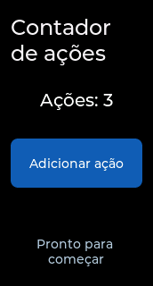

# Integração do núcleo — versão 0.3.0

> Registro histórico anterior à adoção do nome EmbedMark em 14/10/2026. Os nomes de arquivos, comandos e resultados abaixo foram preservados para rastreabilidade; consulte o [guia de publicação atual](PUBLICACAO.md) para os novos pacotes.

Etapa concluída em 28/09/2026: o código gerado agora pode ser conectado à lógica da aplicação por IDs e eventos LVGL. A versão anterior foi preservada em `backups/tcc-ui-translator_0.2.0_antes_da_integracao.zip` no workspace do TCC.

## Entregas

- `screen_main_create`, `screen_main_get`, `screen_main_get_object` e `screen_main_destroy`: criação, reutilização, busca e destruição da tela.
- Atualização da tabela de IDs quando objetos, ancestrais ou a raiz são excluídos. IDs desconhecidos e objetos removidos retornam `NULL`.
- Proteção contra destruição da tela ativa, de origem/destino de transição ou com animação pendente.
- Catálogo externo de fontes por CLI/API, com validação de símbolos, tamanhos, arquivos e intervalos Unicode. Diagnósticos consideram a fonte efetivamente selecionada.
- Fontes TCC Sans PT em 14, 20 e 24 pixels, com acentos portugueses, licença e arquivos para reproduzir sua geração.
- Exemplo de contador com eventos e código da aplicação separado. O preparador reúne código gerado, controlador, fontes e fragmento CMake; preserva um controlador modificado.
- Manual da API, manual de fontes e guia de integração ESP-IDF atualizados.

## Verificações realizadas

101 testes passaram localmente. A compilação dos arquivos de interface continuou usando `riscv32-esp-elf-gcc` 14.2.0 e headers LVGL 8.3.11. A execução nativa usou LLVM Clang 20.1.6, SDK e linker das Command Line Tools instaladas, sem aceitar licenças ou alterar a configuração global do sistema.

O teste de execução compila e vincula os fontes reais do LVGL, as três fontes, a interface e o controlador. Ele registra um display em memória e verifica:

- Falta de display, busca de IDs, acesso à raiz e IDs desconhecidos.
- Repetição da criação e inicialização do controlador sem duplicar callbacks.
- Cliques e atualização para “Ações: 3”.
- Seleção de fonte, dimensões e existência de cada glifo declarado no catálogo.
- Exclusão de um ancestral, exclusão externa da raiz e invalidação dos acessos.
- Recusa de destruição durante transições, inclusive com atraso.
- 100 ciclos de criação, clique e destruição; a memória livre monitorada pelo LVGL foi igual antes e depois desses ciclos, e a verificação de integridade passou.

Essa observação de memória é uma regressão no ambiente de teste, não uma medição de RAM, energia ou desempenho do ESP32-C6. Os estilos compartilhados permanecem alocados durante a vida do LVGL. As limitações de ciclo de vida estão na [API](API_FIRMWARE.md).

Ruff aprovou a análise e a formatação dos módulos, testes e ferramentas auxiliares. O wheel 0.3.0 foi instalado em ambiente virtual novo com Python 3.12.14; CLI, catálogo externo e preparação do exemplo foram executados fora da pasta do projeto. O workflow remoto foi atualizado, mas ainda não foi executado no repositório remoto.

## Captura da execução

Esta imagem foi produzida pelo LVGL executado no computador, em 172 × 320 pixels, após três eventos de clique enviados pelo teste. Não é uma fotografia da placa nem uma aproximação renderizada por navegador.



## Reprodução

```sh
python tools/prepare_demo.py
LVGL_DIR=/caminho/lvgl CC=cc HOST_CC=cc python -m pytest -q
```

Para separar os compiladores, `CC` pode apontar para o RISC-V e `HOST_CC` para o compilador nativo. No ambiente local, o compilador nativo recebeu `HOST_CFLAGS='-isysroot /Library/Developer/CommandLineTools/SDKs/MacOSX.sdk'` e `HOST_LDFLAGS='-fuse-ld=/Library/Developer/CommandLineTools/usr/bin/ld'`.

Os arquivos preparados estão em `output/interacao`. Consulte [integração ESP-IDF](../ESP_IDF_INTEGRATION.md), [fontes](FONTES.md) e [API](API_FIRMWARE.md).

## Pendências

O build completo do firmware ESP-IDF, o dispositivo de entrada e a aparência/interação na placa continuam pendentes. Não houve gravação de firmware. A extensão do VS Code, os testes da matriz de sistemas, publicação e reescrita acadêmica como produto permanecem nas próximas etapas. A versão atual atende uma instância de tela por saída gerada; múltiplas saídas vinculadas exigem uma evolução de namespaces.
