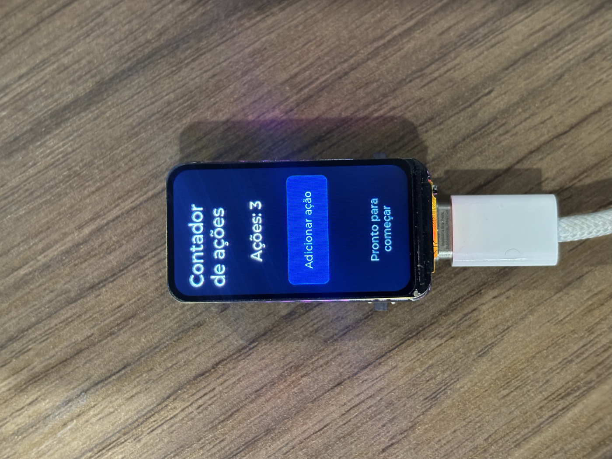

# Validação física na Waveshare ESP32-C6-LCD-1.47

Em **11 de novembro de 2026**, uma interface de contador gerada pelo núcleo **EmbedMark 0.4.2** foi compilada e executada na placa comercial **Waveshare ESP32-C6-LCD-1.47**, com display integrado. O ensaio pelo console aprovou **143 verificações, sem falhas**, incluindo um bloco de **50 ciclos de recriação e incremento** e **10 ciclos de alternância entre padrão de cores e interface**. A conferência visual complementar confirmou cores, orientação, enquadramento e textos acentuados.

Este documento publica evidências de um ensaio já realizado. A fotografia mostra um estado da interface; a sequência de comandos e respostas está nos registros seriais. Os resultados se referem à placa, ao firmware e ao procedimento identificados abaixo, e são separados dos testes automatizados históricos do projeto.

## Configuração examinada

| Item | Configuração registrada |
|---|---|
| Placa | Waveshare ESP32-C6-LCD-1.47, sem touch |
| Microcontrolador detectado | ESP32-C6FH4, revisão 0.1, flash de 4 MB |
| Display | 1,47 polegada, 172 × 320 pixels, retrato |
| Controlador e driver | ST7789, conforme fabricante; driver local `Vernon_ST7789T` |
| Núcleo gerador | EmbedMark 0.4.2 |
| Commit do tradutor registrado | `309a492a9f585eabbfc59a1ea906c89687b22642` |
| Firmware do laboratório | 0.1.0; numeração própria, distinta da versão do tradutor |
| Ambiente | ESP-IDF `v5.4.3-dirty`, LVGL 8.3.11 |
| Interface SPI do LCD | SPI2, 12 MHz configurados, modo 0, MISO desabilitado |
| Transferências | Comandos e parâmetros de 8 bits, fila de 10, DMA automático |
| Orientação | Offset X=34/Y=0; `mirror_x=true`, `mirror_y=false`, `swap_xy=false` |
| Pixels | RGB565, ordem BGR, `LV_COLOR_16_SWAP=0` |
| Inicialização do painel | RAMCTRL `0xB0` com parâmetros `{0x00, 0xE8}`, preservados do exemplo do fabricante |
| Buffers e temporização LVGL | Dois buffers de 172 × 20 pixels; tick de 2 ms |
| Iluminação | 50%, com limite de 50% neste perfil; PWM configurado em 5 kHz e 13 bits |
| Console | **USB Serial/JTAG principal**, pelo USB-C nativo |
| Estado inicial | Incremento automático desligado |

| Sinal do LCD | GPIO |
|---|---:|
| SCLK | 7 |
| MOSI | 6 |
| **CS** | **14** |
| DC | 15 |
| RST | 21 |
| BL | 22 |

O perfil utilizado foi `TCC_PINS_WAVESHARE`. **CS é GPIO14 neste ensaio**; o perfil anterior que utilizava GPIO23 não foi usado. A placa integrada é distinta da montagem anterior com nanoESP32-C6 e LCD externo de 1,9 polegada, e também do produto ESP32-C6-Touch-LCD-1.47. As evidências desta página pertencem somente à placa aqui identificada.

`Vernon_ST7789T` é o nome do driver herdado do exemplo; não constitui identificação independente de um sufixo físico do controlador. Frequências, buffers e parâmetros da tabela são configurações do firmware, sem medição elétrica correspondente. No log de inicialização, os 80 MHz do SPI da **flash** não representam a frequência configurada para o **LCD**.

## Preparação e identificação do firmware

O contador foi regenerado de `interfaces/contador.html` pelo núcleo Python 0.4.2 e incorporado ao projeto local isolado `embedmark-validation-waveshare`. Este ensaio físico exercitou a saída gerada pelo núcleo; não corresponde, isoladamente, a uma nova execução dos comandos da extensão do VS Code.

Antes da gravação, foi preservada uma leitura completa de **4.194.304 bytes** da flash original e realizada sua comparação com a própria flash, com resultado `verify OK (digest matched)`. O backup permanece local. Bootloader, tabela de partições e aplicação foram gravados, e a ferramenta de gravação verificou seus hashes após a escrita.

| Artefato identificado | Tamanho | SHA-256 |
|---|---:|---|
| Aplicação `embedmark-validation.bin` | 477.552 bytes | `3dddf02e8b0bfca432f191b92f2147e80dec366cadd878b0ec56aebbe0dfa4d3` |
| Entrada `contador.html` | 704 bytes | `b16e2577fbbea4e38bc6eb870fb5d4053917186e1265f2feb8a149807633a370` |

O [manifesto público](validation/waveshare-2026-11-11/manifest.json) preserva os hashes registrados dos 25 artefatos locais, incluindo configuração e arquivos gerados. Esses hashes identificam o material utilizado; não significam que todos esses arquivos estão distribuídos nesta pasta. Os 25 tamanhos e hashes foram conferidos novamente contra os arquivos locais ao preparar esta documentação.

A compilação foi concluída no ESP-IDF `v5.4.3-dirty`. O ambiente apresentava um aviso de submódulo OpenThread fora da revisão esperada, que foi preservado no registro local. O ambiente global não foi alterado e o ensaio não exercitou OpenThread. A execução registrada não certifica reprodução em um SDK sem essas diferenças.

## Procedimento e resultados

O script do laboratório enviou os comandos e registrou as respostas pelo console USB Serial/JTAG. A rodada durou **42,59 segundos no total, incluindo a janela inicial de 3,5 segundos** prevista para conexão e inicialização. A duração descreve o protocolo e suas esperas; não é uma medida de desempenho da interface.

Na abertura do USB ocorreu uma reinicialização `USB_UART_HPSYS`, registrada no início do log. O script configurou DTR/RTS como falsos antes de abrir a porta e admitiu o boot apenas na janela inicial. Não houve erro de firmware ou nova reinicialização depois dessa janela durante a rodada. O comportamento de abertura e fechamento depende do ambiente USB; não se deve deduzir ausência de reset físico apenas da configuração dessas linhas.

| Etapa | Resultado observado pelo console |
|---|---|
| Ajuda, recriação e três incrementos | Respostas esperadas; contador 1, 2 e 3 |
| Padrão de cores, retorno e novo incremento | Estado preservado; contador 4 |
| Nova recriação e incremento | Contador reiniciado e incrementado para 1 |
| Automático ligado e desligado | Incrementos 2, 3 e 4; confirmação OFF e intervalo sem incrementos |
| 50 ciclos `r`, `c` | Recriação confirmada e contador 1 em cada ciclo |
| 10 ciclos `p`, `g` | Padrão/interface confirmados em cada ciclo; clique posterior produziu 2 |
| Preparação final | Recriação, três incrementos e intervalo sem novos incrementos; **Ações: 3**, automático OFF |

Os 10 ciclos de alternância contêm uma ida ao padrão e uma volta à interface em cada ciclo. As 50 recriações são o bloco repetido do protocolo; a preparação e o encerramento também contêm recriações. A contagem de **143** se refere às verificações individuais registradas, incluindo a janela inicial, e não a 143 cenários independentes.

O [resultado completo](validation/waveshare-2026-11-11/result.json) contém as 143 verificações aprovadas, zero reprovadas e o estado final. Os [631 eventos](validation/waveshare-2026-11-11/events.jsonl) registram comandos, respostas e verificações com tempos relativos. As 143 entradas de verificação nesse arquivo coincidem com as do resultado. O [log recebido da placa](validation/waveshare-2026-11-11/serial-rx.log) foi preservado byte a byte, com 10.168 bytes.

O status `passed_serial_only` e o campo de validação visual pendente do resultado foram mantidos: são a saída original da etapa automática, que não observa o painel. A confirmação visual complementar está registrada separadamente em [visual-validation.json](validation/waveshare-2026-11-11/visual-validation.json).

## Conferência visual

Na conferência visual complementar, o responsável pela placa confirmou o padrão vermelho, verde, azul e branco, os nomes correspondentes e a borda completa. Também confirmou os textos e o estado **Ações: 3** no contador. O registro visual identifica o título e o rodapé em duas linhas, os acentos e os elementos dentro da área visível.

*Fonte: fotografia do autor, de 11 nov. 2026. Prévia da fotografia adicional IMG_6242, selecionada para o TCC.*

A primeira confirmação fotográfica foi registrada em IMG_6241. A fotografia adicional IMG_6242, apresentada acima, documenta o mesmo estado e foi escolhida pelo autor para o TCC. Os originais permanecem no acervo local. A cópia pública reutiliza a prévia já existente, sem recorte, alteração de pixels ou tratamento generativo; somente metadados de captura e localização foram removidos. A fotografia comprova um estado visível. A sequência de eventos é documentada pelos registros seriais, e a confirmação das faixas de cores é uma observação declarada pelo responsável pela placa.

## Como interpretar e repetir o protocolo

O firmware do laboratório e seu controlador permanecem em um projeto local separado. **Este conjunto é documental: clonar este repositório não fornece, por si só, o firmware completo para repetir o ensaio.** Os comandos abaixo pertencem à aplicação daquele laboratório; não são comandos nativos do ESP32 nem da extensão.

Com uma integração equivalente preparada e conferida, o roteiro manual é: observar o padrão de cores; solicitar ajuda com `h`; recriar com `r`; enviar `c` três vezes e observar o contador; alternar `p` e `g`, conferindo a preservação do estado; recriar novamente; alternar `a` para observar o automático e depois desligá-lo. Repetir os blocos de 50 recriações/incrementos e 10 ciclos padrão/interface, registrando cada resposta. Ao final, recriar, enviar três cliques e conferir **Ações: 3** com automático desligado. `r` recria a interface, sem solicitar reinicialização do microcontrolador.

Na rodada registrada, o limite por resposta foi de 5 segundos, por incremento automático de 4,5 segundos e para a rodada inteira de 180 segundos. Os intervalos sem incremento exigiam ao menos 2,2 segundos. A primeira atualização automática pode ocorrer antes de 2 segundos, pois o temporizador não reinicia quando recebe `a`. A inspeção visual foi feita separadamente; o protocolo automático não pausa para fotografias.

## Alcance das evidências

- Foram exercitados criação da interface, acesso aos componentes, atualização de texto, eventos de clique enviados por software, temporização e alternância de telas no firmware examinado.
- Não houve entrada por touch ou botão físico. O botão desenhado na tela não implica que o painel seja sensível ao toque.
- O ensaio curto não mede consumo, taxa de quadros, frequência elétrica do SPI, ocupação de memória ou estabilidade prolongada. Os 477.552 bytes identificam o arquivo da aplicação, não o uso de RAM.
- A execução não avalia os demais periféricos da placa nem transfere seus resultados automaticamente para outras placas, controladores ou configurações.
- Os resultados complementam a avaliação de software; não são somados ao total histórico de testes nem comprovam ausência geral de defeitos.

## Organização pública e omissões

A pasta [waveshare-2026-11-11](validation/waveshare-2026-11-11/) contém resultado, eventos, log serial, registro visual, manifesto e uma prévia fotográfica. [SHA256SUMS](validation/waveshare-2026-11-11/SHA256SUMS) identifica os arquivos dessa cópia pública.

O nome da porta local foi substituído por `<PORTA_LOCAL_OMITIDA>` em `result.json` e no primeiro evento de `events.jsonl`. O caminho absoluto do projeto foi reduzido ao nome do laboratório no manifesto. A fotografia teve os metadados EXIF/XMP/texto originais removidos; foi mantido somente um campo EXIF mínimo de orientação, necessário para exibi-la em retrato. Os dados de imagem comprimidos e os pixels foram preservados. Os hashes da prévia original e da cópia pública permitem distinguir as duas versões. O registro visual público mantém a confirmação e identifica quais fotografias ficaram locais.

Não foram incluídos backup integral da flash, binários, ELF, fotografias originais ou conversões grandes, logs de compilação/gravação/backup com caminhos ou identificadores do dispositivo, arquivos de credenciais ou código de outros protótipos. Os registros locais completos continuam preservados. A seleção e as alterações de publicação estão descritas no manifesto; as verificações, respostas, tempos relativos e estado final do ensaio não foram alterados.

## Referências técnicas

Documentação oficial consultada para preparar o ensaio de 11 nov. 2026:

- [Waveshare — ESP32-C6-LCD-1.47: especificações, pinagem e recomendação de brilho](https://docs.waveshare.com/ESP32-C6-LCD-1.47).
- [Waveshare — esquema elétrico da placa](https://files.waveshare.com/wiki/ESP32-C6-LCD-1.47/ESP32-C6-LCD-1.47_schemetics.pdf).
- [Waveshare — exemplo ESP-IDF](https://docs.waveshare.com/ESP32-C6-LCD-1.47/ESP-IDF).
- [Waveshare — pacote de exemplos](https://files.waveshare.com/wiki/ESP32-C6-LCD-1.47/ESP32-C6-LCD-1.47-Demo.zip).
- [Waveshare — FAQ](https://docs.waveshare.com/ESP32-C6-LCD-1.47/FAQ).
- [Espressif — console USB Serial/JTAG, ESP-IDF 5.4.3 para ESP32-C6](https://docs.espressif.com/projects/esp-idf/en/v5.4.3/esp32c6/api-guides/usb-serial-jtag-console.html).

O pacote oficial examinado tinha 62.844.090 bytes e SHA-256 `4b960e8ccd58e54e60494a2a6da62531695c9152c9950153cad34acc496c4ee4`. Esse identificador fixa a referência utilizada, pois o fabricante pode atualizar o arquivo no mesmo endereço.
